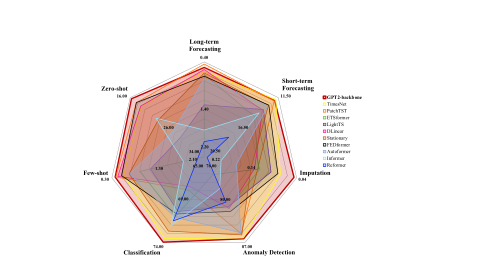

# pdf-figure-extract

[](https://code.claude.com/docs/en/skills)
[](https://agentskills.io)
[](https://skills.sh/llm-paper-reading/pdf-figure-extract)
[](LICENSE)

从论文 PDF 中安全抽取 Figure 为 **PNG / SVG** 的通用 Agent Skill，遵循 [Agent Skills 开放规范](https://agentskills.io)，可用于 Claude Code、Codex、Cursor、Cline、Gemini CLI 等客户端。

杜绝抽图最常见的四类问题：

- ✂️ **贴边裁剪** —— 顶部/底部文字被切一半、坐标轴没截全
- 📰 **混入杂质** —— 论文自带 caption、正文段落、页眉被裁进图里
- 🔗 **双栏误判** —— 把另一栏的图或正文并进同一张图
- ❌ **图 404** —— 只写了引用没产出文件

## 效果对比：从 PDF 抽取 vs 官方仓库图片

以 NeurIPS 2023 论文 [One Fits All（arXiv:2302.11939）](https://arxiv.org/abs/2302.11939) 为例。其[官方仓库](https://github.com/DAMO-DI-ML/NeurIPS2023-One-Fits-All)提供了现成的 `pic/main_result.png`，与本技能从 PDF 抽出的同名图对比：

<table>
<tr>
<td width="50%" align="center">
<br>
<sub>官方仓库 <code>pic/main_result.png</code>：PNG 位图 1064×934，389 KB，<b>图注被一起截进图片</b></sub>
</td>
<td width="50%" align="center">
<br>
<sub>本技能抽取：SVG 矢量，140 KB，<b>不含图注</b>，任意放大不失真</sub>
</td>
</tr>
</table>

同篇论文两组图的量化对比：

| 图 | 来源 | 格式 | 尺寸 | 文件大小 | 图注 |
|---|---|---|---|---|---|
| Figure 1 | 官方仓库 `main_result.png` | PNG 位图 | 1064×934 | 389 KB | ✗ 含图注 |
| Figure 1 | 本技能 `extract_svg.py` | SVG 矢量 | 无限缩放 | **140 KB** | ✓ 不含 |
| Figure 1 | 本技能 `extract_fig.py` | PNG 300 dpi | **2049×1159** | 361 KB | ✓ 不含 |
| Figure 2 | 官方仓库 `model_structure.png` | PNG 位图 | 1474×822 | 221 KB | ✗ 含图注 |
| Figure 2 | 本技能 `extract_svg.py` | SVG（含 11 个内嵌位图） | 无限缩放 | 279 KB | ✓ 不含 |
| Figure 2 | 本技能 `extract_fig.py` | PNG 300 dpi | 1484×863 | **153 KB** | ✓ 不含 |

结论：

- **更清晰**：矢量图优先走 SVG，文字与线条是路径而非像素，放大到任意倍率都不糊；必须用位图时，300 dpi 输出（2049×1159）也高于官方仓库常见的 1000 px 级别；
- **通常更小**：Figure 1 的 SVG 只有官方 PNG 的 36%；但**不保证**——Figure 2 的矢量路径与内嵌图标更复杂，SVG 反而比官方 PNG 大（279 KB vs 221 KB），这种情况用 PNG 模式更划算（153 KB）；
- **不夹带图注**：官方仓库的两张图都把 `Figure N: ...` 图注和正文一起截了进去，放进网页要再处理一次；本技能以 caption 为锚点，天然停在图注之前；
- **不依赖作者是否提供图片**：绝大多数论文没有官方图片目录，本技能对任意 PDF 都能产出结果；
- **可复现、可抽查**：一条命令生成并自检，能写进 CI，换版本或换图后可重新跑。

> 对比图中的图形版权归论文作者，论文采用 [CC BY-NC-SA 4.0](http://creativecommons.org/licenses/by-nc-sa/4.0/) 许可，仅用于非商业展示，不在本仓库 MIT 许可范围内。官方仓库图片未复制进本仓库，仅通过原始链接引用。详见 [docs/comparison/README.md](docs/comparison/README.md)。

## 支持平台

| 客户端 | 加载位置 | 安装方式 |
|---|---|---|
| Claude Code | `.claude/skills/`、`~/.claude/skills/` | skills CLI / plugin / 源码 |
| Codex CLI | `.agents/skills/`、`~/.agents/skills/` | skills CLI / 源码 |
| Cursor、Cline、Gemini CLI、Windsurf、GitHub Copilot、OpenCode 等 | `.agents/skills/`、`~/.agents/skills/` | skills CLI / 源码 |
| 其他 Agent Skills 客户端 | 见各自文档 | 源码（`install.sh` 软链） |

## 安装

### 方式一：skills CLI（推荐，自动识别已装客户端）

```bash
# 项目级，交互选择要装给哪些 agent
npx skills add llm-paper-reading/pdf-figure-extract

# 只装给 Claude Code 与 Codex，用户级，免交互
npx skills add llm-paper-reading/pdf-figure-extract -g -a claude-code -a codex -y

# 固定版本
npx skills add llm-paper-reading/pdf-figure-extract@v1.1.0 -a claude-code
```

### 方式二：Claude Code 插件

```bash
claude plugin marketplace add llm-paper-reading/pdf-figure-extract
claude plugin install pdf-figure-extract@llm-paper-reading-skills
```

也可在 Claude Code 会话内一步完成：

```text
/plugin install pdf-figure-extract --marketplace llm-paper-reading/pdf-figure-extract
```

### 方式三：源码安装

```bash
git clone https://github.com/llm-paper-reading/pdf-figure-extract.git
cd pdf-figure-extract

# 默认装给 Claude Code（用户级软链接）
./install.sh

# 装给 Codex / Cursor 等（~/.agents/skills）
./install.sh -a codex

# 同时装给多个客户端；-p 装到当前项目；--copy 复制而非软链
./install.sh -a claude-code,codex
cd your-project && /path/to/pdf-figure-extract/install.sh -p -a claude-code

# 查看目标路径或覆盖已存在安装
./install.sh --list
./install.sh --force
```

手动软链等价写法：

```bash
# Claude Code
ln -s "$PWD/skills/pdf-figure-extract" ~/.claude/skills/pdf-figure-extract
# Codex / Cursor / Cline 等
ln -s "$PWD/skills/pdf-figure-extract" ~/.agents/skills/pdf-figure-extract
```

### 方式四：直接放进项目

把 `skills/pdf-figure-extract/` 整个目录复制到项目的 `.claude/skills/` 或 `.agents/skills/` 下即可，目录名保持 `pdf-figure-extract`。

## 依赖

| 依赖 | 用途 | 安装 |
|---|---|---|
| Python 3.10+ | 运行脚本 | — |
| [PyMuPDF](https://pymupdf.readthedocs.io/) | PDF 解析、渲染 | `pip install pymupdf pillow numpy` |
| [poppler](https://poppler.freedesktop.org/) | `pdftocairo` SVG 转换 | macOS: `brew install poppler` |
| [librsvg](https://gitlab.gnome.org/GNOME/librsvg) | `rsvg-convert`（仅 SVG 边界检查） | macOS: `brew install librsvg` |

## 使用

安装后对 agent 说「从论文抽取 Figure 2」即可自动触发；也可直接调脚本（脚本位于本 skill 目录的 `scripts/` 下）：

```bash
cd /tmp && mkdir work && cd work
curl -sL -o paper.pdf "https://arxiv.org/pdf/2205.14135"

# 矢量图 → SVG（推荐，任意缩放不失真）
python <skill-dir>/scripts/extract_svg.py paper.pdf 2 1 fig1.svg

# 位图 → PNG（自动注入 1.2% 白边；FlashAttention 的 Figure 2 在第 6 页）
python <skill-dir>/scripts/extract_fig.py paper.pdf 6 2 fig2.png

# 双栏页 / 特殊图注（Figure 1 |、Fig. 1: 等）→ 显式矩形（pt）
# 例：vLLM 论文第 5 页右栏的 Figure 5
python <skill-dir>/scripts/extract_svg.py paper.pdf 5 5 fig5.svg --clip "318,40,560,168"

# 批量边界检查（PNG / JPG / SVG / 目录）
python <skill-dir>/scripts/check_border.py path/to/images/
```

每个脚本都内置自检：提取后立即检查四边墨迹比例，超阈值（0.3%）即以退出码 3 报 WARN，不会静默输出坏图。

## 工作原理

1. **caption 锚定**：以 `Figure N:` 图注文本行 bbox 为锚点，向「上」合并 image/vector 块并集作为图区，硬停在 caption 之前；
2. **安全边距**：PNG 模式注入 1.2% 白边后自检四边；SVG 模式校验 clip 矩形边界；
3. **背景感知**：边界检查以四角颜色估计背景，深色主题图不误报。

详细设计、已知坑与对策见 [skills/pdf-figure-extract/SKILL.md](skills/pdf-figure-extract/SKILL.md)。

## 已验证场景

- arXiv 单栏技术报告（DeepSeek-V3、Llama 3、Kimi K2/K3、GLM-5 等）
- 双栏论文（vLLM、Attention Is All You Need、KD 综述）
- 章节式图编号（GPT-3 的 `Figure 3.1`）
- 非冒号图注（`Figure 2 |`）
- 双子图拆分（同一 Figure 的左右子图独立提取）

## 不适用

- 网页 / 博客截图来源（非 PDF）：贴边只能重新截图；
- 跨页图：需手工处理。

## 目录结构

```text
pdf-figure-extract/
├── plugin.json                  # 通用 Agent Plugins 清单
├── .claude-plugin/              # Claude Code 插件与 marketplace 清单、图标
├── skills/pdf-figure-extract/   # 技能本体（SKILL.md + scripts + Codex 元数据）
├── docs/comparison/             # README 效果对比用的抽取结果与说明
├── tests/                       # 单元、回归、CLI、README 冒烟、打包校验
├── install.sh                   # 源码安装（软链 / 复制到各 agent 目录）
└── AGENTS.md                    # 给仓库内编码 agent 的约定
```

## 测试

```bash
pip install -r requirements-dev.txt

# 离线：单元 + 回归 + CLI + 打包校验
python -m pytest tests/ -q

# README 命令逐条冒烟（联网下载 arXiv PDF）
python -m pytest tests/test_readme_commands.py --net -q
```

测试分层：

- `tests/test_unit.py`：caption 锚定（含章节编号、无交叉误配）、边界墨迹检测（含深色背景不误报）、错误路径；
- `tests/test_regression.py`：历史 bug 回归（图内图例 TXT 块被切、两脚本 figure_clip 行为一致性）；
- `tests/test_cli.py`：CLI 退出码、`--clip` 跳过 caption 查找、PNG 白边注入、check_border 目录扫描；
- `tests/test_readme_commands.py`：README 示例命令原样执行（默认跳过，`--net` 开启）；
- `tests/test_packaging.py`：frontmatter 规范、三处版本号一致、marketplace 条目、`install.sh` 行为。

## License

[MIT](LICENSE)
