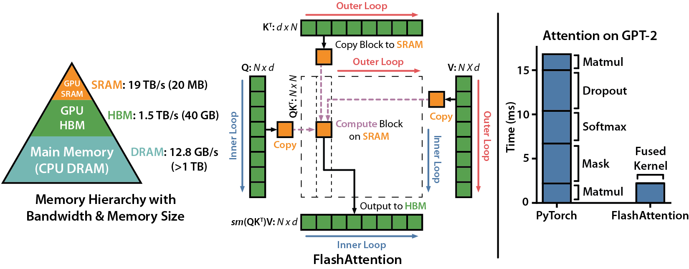
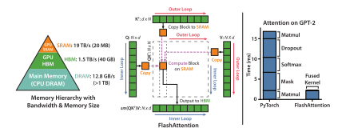
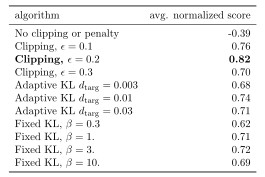
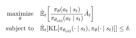

# pdf-figure-extract

[](https://code.claude.com/docs/en/skills)
[](https://agentskills.io)
[](LICENSE)

从论文 PDF 中抽取可直接使用的图片：矢量内容输出 **SVG**（推荐），位图内容输出 **PNG**。除了架构图、流程图、曲线图，也能抽取**表格**、**算法伪代码**、**公式**，以及任意用 `--clip` 框选的区域。遵循 [Agent Skills 开放规范](https://agentskills.io)，可安装到 Claude Code、Codex、Cursor、Cline、Gemini CLI 等客户端。

## 1. 能抽取什么

| 类型 | 典型内容 | 定位方式 |
|---|---|---|
| Figure | 架构图、流程图、曲线图、实验对比图 | 自动识别 `Figure N:` 图注 |
| Table | 实验结果表、消融表 | `--clip` 指定区域（含表头与横线，不含 caption） |
| Algorithm | 算法伪代码、流程伪代码 | `--clip` 指定区域（含缩进、数学符号与上下框线） |
| Formula | 单条公式，或连续多条公式合并成一张图 | `--clip` 指定区域 |
| 其他 | 任意图区、特殊排版区域 | `--clip` |

Figure 有统一图注，可以自动锚定；表格、算法伪代码和公式没有固定格式，用 `--clip` 精确框选即可，都支持 SVG / PNG 与自动背景。

### 1.1 架构图

以 **FlashAttention**（[arXiv:2205.14135](https://arxiv.org/abs/2205.14135)）为例，官方仓库 README 的 `flashattn_banner.jpg` 就是论文 Figure 1：

<table>
<tr>
<td width="50%" align="center">
<br>
<sub>官方 JPG：1650×645，315 KB</sub>
</td>
<td width="50%" align="center">
<br>
<sub>本技能 SVG：160 KB（约官方 51%）· 矢量可缩放</sub>
</td>
</tr>
</table>

### 1.2 表格、伪代码与公式

表格、算法伪代码和公式没有 `Figure N:` 图注，用 `--clip` 框选即可。示例来自 PPO 论文（[arXiv:1707.06347](https://arxiv.org/abs/1707.06347)），`$SKILL_DIR` 指 skill 安装目录：

<table>
<tr>
<td align="center">
<br>
<sub>Table 示例</sub>
</td>
<td align="center">
<br>
<sub>Algorithm 示例</sub>
</td>
<td align="center">
<br>
<sub>公式示例</sub>
</td>
</tr>
</table>

<details>
<summary><sub>抽取命令（可选，点击展开）</sub></summary>

```bash
curl -sL -o ppo.pdf "https://arxiv.org/pdf/1707.06347"

# Algorithm 示例（第 5 页）
python "$SKILL_DIR/scripts/extract_svg.py" ppo.pdf 5 1 ppo-algorithm1.svg --clip "60,455,535,600"

# Table 示例（第 6 页；上界要留出表头）
python "$SKILL_DIR/scripts/extract_svg.py" ppo.pdf 6 1 ppo-table1.svg --clip "165,370,430,547"

# 公式示例（第 2 页；合并为一个 SVG，右侧编号不包含在 clip 内）
python "$SKILL_DIR/scripts/extract_svg.py" ppo.pdf 2 3 ppo-formulas-3-4.svg --clip "185,446,410,509"
```

</details>

## 2. 安装

### 2.1 安装方式

> 推荐用 skills CLI 一条命令安装，会自动识别已安装的客户端。需要 Node.js 22.20+。

```bash
# 交互式安装
npx skills add llm-paper-reading/pdf-figure-extract
```

<details>
<summary>通过 Claude Code 插件</summary>

```bash
claude plugin marketplace add llm-paper-reading/pdf-figure-extract
claude plugin install pdf-figure-extract@llm-paper-reading-skills
```

也可在 Claude Code 会话内一步完成：

```text
/plugin install pdf-figure-extract --marketplace llm-paper-reading/pdf-figure-extract
```

</details>

<details>
<summary>从源码安装</summary>

```bash
git clone https://github.com/llm-paper-reading/pdf-figure-extract.git
cd pdf-figure-extract

# 默认装给 Claude Code（用户级软链接）
./install.sh

# 装给 Codex / Cursor 等（~/.agents/skills）
./install.sh -a codex

# 同时装给多个客户端；-p 装到当前项目；--copy 复制而非软链
./install.sh -a claude-code,codex
cd your-project && /path/to/pdf-figure-extract/install.sh -p -a claude-code

# 查看目标路径或覆盖已存在安装
./install.sh --list
./install.sh --force
```

手动软链等价写法：

```bash
mkdir -p ~/.claude/skills ~/.agents/skills

# Claude Code
ln -s "$PWD/skills/pdf-figure-extract" ~/.claude/skills/pdf-figure-extract
# Codex / Cursor / Cline 等
ln -s "$PWD/skills/pdf-figure-extract" ~/.agents/skills/pdf-figure-extract
```

</details>

<details>
<summary>手动放入项目</summary>

把 `skills/pdf-figure-extract/` 整个目录复制到项目的 `.claude/skills/` 或 `.agents/skills/` 下即可，目录名保持 `pdf-figure-extract`。

</details>

### 2.2 依赖

| 依赖 | 用途 | 安装 |
|---|---|---|
| Python 3.10+ | 运行脚本 | — |
| [PyMuPDF](https://pymupdf.readthedocs.io/) | PDF 解析、渲染 | `pip install pymupdf pillow numpy` |
| [poppler](https://poppler.freedesktop.org/) | `pdftocairo` SVG 转换 | macOS: `brew install poppler` |
| [librsvg](https://gitlab.gnome.org/GNOME/librsvg) | `rsvg-convert`（仅 SVG 边界检查） | macOS: `brew install librsvg` |

脚本以 macOS / Linux 为主；Windows 建议使用 WSL 或 Git Bash，并确保 `pdftocairo`、`rsvg-convert` 在 `PATH` 中。

## 3. 使用

安装后对 agent 说「从论文抽取 Figure 2」即可自动触发；也可直接调脚本（脚本位于本 skill 目录的 `scripts/` 下）：

```bash
cd /tmp && mkdir work && cd work
curl -sL -o paper.pdf "https://arxiv.org/pdf/2205.14135"

# 换成你的安装路径（skills CLI 与插件安装位置不同）
SKILL_DIR=~/.claude/skills/pdf-figure-extract

# 矢量图 → SVG（推荐，任意缩放不失真）
python "$SKILL_DIR/scripts/extract_svg.py" paper.pdf 2 1 fig1.svg

# 仅当图中本身是照片 / 扫描位图时用 PNG（自动注入 1.2% 边距，颜色跟随背景；放大受像素限制）
python "$SKILL_DIR/scripts/extract_fig.py" paper.pdf 6 2 fig2.png

# 双栏页 / 特殊图注（Figure 1 |、Fig. 1: 等）→ 显式矩形（pt）
# 例：vLLM 论文第 5 页右栏的 Figure 5
curl -sL -o vllm.pdf "https://arxiv.org/pdf/2309.06180"
python "$SKILL_DIR/scripts/extract_svg.py" vllm.pdf 5 5 fig5.svg --clip "318,40,560,168"

# 批量边界检查（PNG / JPG / SVG / 目录）
python "$SKILL_DIR/scripts/check_border.py" path/to/images/
```

自动锚定只支持 `Figure N:` 图注；表格、算法伪代码和公式没有统一的图注结构，用 `--clip` 显式指定区域即可（示例见 1. 能抽取什么）。`--background` 默认 `auto`：论文自带深色底时保留，否则补白底；`transparent` 保持透明，让页面背景透出。

`extract_fig.py` 与 `check_border.py` 会检查四边墨迹比例，超阈值（0.3%）即以退出码 3 报 WARN；`extract_svg.py` 负责渲染与 clip，SVG 的边界复检请配合 `check_border.py`。

## 4. 工作原理

1. **caption 锚定**：以 `Figure N:` 图注文本行 bbox 为锚点，向「上」合并 image/vector 块并集作为图区，硬停在 caption 之前；表格、算法伪代码与公式用 `--clip` 跳过这一步；
2. **安全边距**：PNG 模式注入 1.2% 边距（颜色跟随背景）后自检四边；SVG 模式检查 caption 命中与输出文件大小，边界用 `check_border.py` 复检；
3. **背景感知**：边界检查以四角颜色估计背景，深色主题图不误报；`auto` 在论文自带深色底时保留，否则补白底。

详细设计、已知坑与对策见 [skills/pdf-figure-extract/SKILL.md](skills/pdf-figure-extract/SKILL.md)。

## 5. 主要优势

- **不止 Figure**：架构图、流程图、表格、算法伪代码、公式都能抽；
- **矢量优先**：矢量内容输出 SVG，任意缩放不失真（若 PDF 内的图本身是位图，SVG 会内嵌原图，放大仍受其分辨率限制）；
- **裁切准确**：以 `Figure N:` 图注为锚点，自动排除图注、正文与页眉；
- **自带质检**：PNG 提取后检查四边墨迹，异常以退出码 3 报 WARN；SVG 可用 `check_border.py` 复检；
- **背景自动适配**：默认 `auto`，论文自带深色底时保留，否则补白底；需要透明可强制 `transparent`（深色页面会透出页面背景），也可强制 `white`；
- **可复现**：纯本地脚本、无外部服务，可写进 CI，换论文或换版本后重跑；
- **多客户端**：同一份 skill 可装到 Claude Code、Codex、Cursor 等客户端。

## 6. 解决的常见抽图问题

- ✂️ **贴边裁剪**：顶部/底部文字被切一半、坐标轴没截全；
- 📰 **混入杂质**：论文自带 caption、正文段落、页眉被裁进图里；
- 🔗 **双栏误判**：把另一栏的图或正文并进同一张图；
- ❌ **图 404**：只写了引用、没产出文件。

## 7. 不适用

- 网页 / 博客截图来源（非 PDF）：贴边只能重新截图；
- 跨页图：需手工处理。

## 8. 目录结构

```text
pdf-figure-extract/
├── plugin.json                  # 通用 Agent Plugins 清单
├── .claude-plugin/              # Claude Code 插件与 marketplace 清单、图标
├── skills/pdf-figure-extract/   # 技能本体（SKILL.md + scripts + Codex 元数据）
├── docs/comparison/             # 效果对比素材与说明
├── docs/examples/               # 表格 / 算法伪代码等额外示例
├── .github/workflows/ci.yml     # CI：测试、plugin 校验、跨工具发现
├── tests/                       # 单元、回归、CLI、README 冒烟、打包校验
├── install.sh                   # 源码安装（软链 / 复制到各 agent 目录）
└── AGENTS.md                    # 给仓库内编码 agent 的约定
```

## 9. License

代码与文档采用 [MIT](LICENSE)。

`docs/comparison/` 与 `docs/examples/` 下的对比图来自论文，版权归原作者：FlashAttention 图形复制自 BSD-3-Clause 官方仓库，PPO 图形按 arXiv 非独占许可使用，均不在 MIT 许可范围内。详见 [docs/comparison/README.md](docs/comparison/README.md) 与 [docs/examples/README.md](docs/examples/README.md)。
