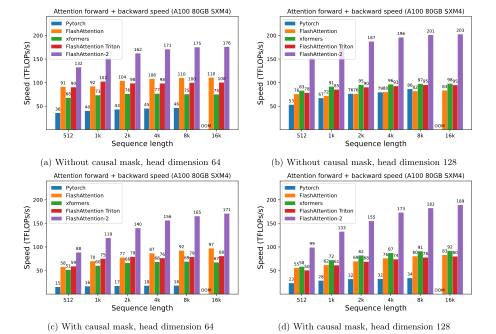

# pdf-figure-extract

[](https://code.claude.com/docs/en/skills)
[](https://agentskills.io)
[](LICENSE)

把论文 PDF 里的 Figure 抽取成可直接使用的图片：矢量内容输出 **SVG**（推荐），位图内容输出 **PNG**。这是一个遵循 [Agent Skills 开放规范](https://agentskills.io) 的通用 skill，同一份内容可安装到 Claude Code、Codex、Cursor、Cline、Gemini CLI 等客户端。

适合把论文中的架构图、流程图、曲线图搬到静态站点、文档或幻灯片，并保证裁切准确、放大清晰、结果可重复生成。

**主要优势**

- **矢量优先**：架构图、流程图抽成 SVG，矢量部分任意缩放不失真（若 PDF 内的图本身是位图，SVG 会内嵌原图，放大仍受其分辨率限制）；
- **裁切准确**：以 `Figure N:` 图注为锚点，自动排除图注、正文与页眉；
- **自带质检**：PNG 提取后检查四边墨迹，异常以退出码 3 报 WARN；SVG 可用 `check_border.py` 复检；
- **背景自动适配**：默认 `auto`，按不透明比例与墨色选择白底或深底；论文自带深色底时保留。也可强制 `white` / `dark` / `transparent`，避免透明 SVG 在深色页面看不清；
- **可复现**：纯本地脚本、无外部服务，可写进 CI，换论文或换版本后重跑；
- **多客户端**：同一份 skill 可装到 Claude Code、Codex、Cursor 等客户端。

## 效果对比：从 PDF 抽取 vs 官方仓库图片

以 **FlashAttention**（[arXiv:2205.14135](https://arxiv.org/abs/2205.14135)）为例，官方仓库 README 的 `flashattn_banner.jpg` 就是论文 Figure 1：

<table>
<tr>
<td width="50%" align="center">
<br>
<sub>官方 JPG：1650×645，315 KB</sub>
</td>
<td width="50%" align="center">
<br>
<sub>本技能 SVG：160 KB，放大不失真</sub>
</td>
</tr>
</table>

同一仓库的 A100 benchmark 图（出自 FlashAttention-2 Figure 4）：

<table>
<tr>
<td width="50%" align="center">
<br>
<sub>官方 PNG：1878×1314，369 KB</sub>
</td>
<td width="50%" align="center">
<br>
<sub>本技能 SVG：313 KB</sub>
</td>
</tr>
</table>

| 图 | 官方图片 | 本技能 SVG | 优势 |
|---|---|---|---|
| Figure 1 | JPG 1650×645，315 KB | **160 KB** | 约为官方 51%，矢量可缩放 |
| A100 benchmark | PNG 1878×1314，369 KB | **313 KB** | 约为官方 85%，矢量可缩放 |

- **更清晰**：SVG 保存路径与字形，矢量部分任意放大不失真，内嵌位图仍受原图分辨率限制；
- **通常更小**：上表两例约为官方图片的 51% 与 85%；
- **不夹带图注**：按 caption 锚定，天然停在 `Figure N: ...` 之前；
- **可复现**：一条命令生成（PNG 模式会自检四边墨迹），可写进 CI。

A100 图上方紧挨正文，抽取时需按 SKILL.md 的「混入正文」对策加 `--clip "57.8,366,554.2,700"`。

**没有官方图片时：Algorithm 1（PPO）**

很多论文没有官方图库，表格和算法伪代码也不属于 Figure。以 PPO 论文（[arXiv:1707.06347](https://arxiv.org/abs/1707.06347)）第 5 页的 Algorithm 1 为例，用 `--clip` 指定区域（`$SKILL_DIR` 指 skill 安装目录）：

```bash
curl -sL -o ppo.pdf "https://arxiv.org/pdf/1707.06347"
python "$SKILL_DIR/scripts/extract_svg.py" ppo.pdf 5 1 ppo-algorithm1.svg --clip "60,455,535,600"
```


抽取结果是 78 KB 的矢量 SVG，缩进、数学符号和上下框线都完整；这类内容没有官方图片可比，但同样可以干净地抽出来。

官方图含图注、复杂矢量 SVG 反而更大等边界案例，见 [docs/comparison](docs/comparison/README.md)。

## 支持平台

| 客户端 | 加载位置 | 安装方式 |
|---|---|---|
| Claude Code | `.claude/skills/`、`~/.claude/skills/` | skills CLI / plugin / 源码 |
| Codex CLI | `.agents/skills/`、`~/.agents/skills/` | skills CLI / 源码 |
| Cursor、Cline、Gemini CLI、Windsurf、GitHub Copilot、OpenCode 等 | `.agents/skills/`、`~/.agents/skills/` | skills CLI / 源码 |
| 其他 Agent Skills 客户端 | 见各自文档 | 手动软链（见方式三） |

## 安装

### 方式一：skills CLI（推荐，自动识别已装客户端）

> 需要 Node.js 22.20+。

```bash
# 项目级，交互选择要装给哪些 agent
npx skills add llm-paper-reading/pdf-figure-extract

# 只装给 Claude Code 与 Codex，用户级，免交互
npx skills add llm-paper-reading/pdf-figure-extract -g -a claude-code -a codex -y

# 固定版本（示例：把 v1.1.0 换成你要的 tag）
npx skills add llm-paper-reading/pdf-figure-extract@v1.1.0 -a claude-code
```

### 方式二：Claude Code 插件

```bash
claude plugin marketplace add llm-paper-reading/pdf-figure-extract
claude plugin install pdf-figure-extract@llm-paper-reading-skills
```

也可在 Claude Code 会话内一步完成：

```text
/plugin install pdf-figure-extract --marketplace llm-paper-reading/pdf-figure-extract
```

### 方式三：源码安装

```bash
git clone https://github.com/llm-paper-reading/pdf-figure-extract.git
cd pdf-figure-extract

# 默认装给 Claude Code（用户级软链接）
./install.sh

# 装给 Codex / Cursor 等（~/.agents/skills）
./install.sh -a codex

# 同时装给多个客户端；-p 装到当前项目；--copy 复制而非软链
./install.sh -a claude-code,codex
cd your-project && /path/to/pdf-figure-extract/install.sh -p -a claude-code

# 查看目标路径或覆盖已存在安装
./install.sh --list
./install.sh --force
```

手动软链等价写法：

```bash
mkdir -p ~/.claude/skills ~/.agents/skills

# Claude Code
ln -s "$PWD/skills/pdf-figure-extract" ~/.claude/skills/pdf-figure-extract
# Codex / Cursor / Cline 等
ln -s "$PWD/skills/pdf-figure-extract" ~/.agents/skills/pdf-figure-extract
```

### 方式四：直接放进项目

把 `skills/pdf-figure-extract/` 整个目录复制到项目的 `.claude/skills/` 或 `.agents/skills/` 下即可，目录名保持 `pdf-figure-extract`。

## 依赖

| 依赖 | 用途 | 安装 |
|---|---|---|
| Python 3.10+ | 运行脚本 | — |
| [PyMuPDF](https://pymupdf.readthedocs.io/) | PDF 解析、渲染 | `pip install pymupdf pillow numpy` |
| [poppler](https://poppler.freedesktop.org/) | `pdftocairo` SVG 转换 | macOS: `brew install poppler` |
| [librsvg](https://gitlab.gnome.org/GNOME/librsvg) | `rsvg-convert`（仅 SVG 边界检查） | macOS: `brew install librsvg` |

脚本以 macOS / Linux 为主；Windows 建议使用 WSL 或 Git Bash，并确保 `pdftocairo`、`rsvg-convert` 在 `PATH` 中。

## 使用

安装后对 agent 说「从论文抽取 Figure 2」即可自动触发；也可直接调脚本（脚本位于本 skill 目录的 `scripts/` 下）：

```bash
cd /tmp && mkdir work && cd work
curl -sL -o paper.pdf "https://arxiv.org/pdf/2205.14135"

# 换成你的安装路径（skills CLI 与插件安装位置不同）
SKILL_DIR=~/.claude/skills/pdf-figure-extract

# 矢量图 → SVG（推荐，任意缩放不失真）
python "$SKILL_DIR/scripts/extract_svg.py" paper.pdf 2 1 fig1.svg

# 仅当图中本身是照片 / 扫描位图时用 PNG（自动注入 1.2% 白边；放大受像素限制）
python "$SKILL_DIR/scripts/extract_fig.py" paper.pdf 6 2 fig2.png

# 双栏页 / 特殊图注（Figure 1 |、Fig. 1: 等）→ 显式矩形（pt）
# 例：vLLM 论文第 5 页右栏的 Figure 5
curl -sL -o vllm.pdf "https://arxiv.org/pdf/2309.06180"
python "$SKILL_DIR/scripts/extract_svg.py" vllm.pdf 5 5 fig5.svg --clip "318,40,560,168"

# 批量边界检查（PNG / JPG / SVG / 目录）
python "$SKILL_DIR/scripts/check_border.py" path/to/images/
```

自动锚定只支持 `Figure N:` 图注；表格、算法伪代码没有统一的图注结构，用 `--clip` 显式指定区域即可（示例见上文「效果对比」）。`--background` 默认 `auto`：按不透明比例与墨色选择白底或深底，论文自带深色底时保留；`transparent` 保持透明。

`extract_fig.py` 与 `check_border.py` 会检查四边墨迹比例，超阈值（0.3%）即以退出码 3 报 WARN；`extract_svg.py` 负责渲染与 clip，SVG 的边界复检请配合 `check_border.py`。

## 工作原理

1. **caption 锚定**：以 `Figure N:` 图注文本行 bbox 为锚点，向「上」合并 image/vector 块并集作为图区，硬停在 caption 之前；
2. **安全边距**：PNG 模式注入 1.2% 白边后自检四边；SVG 模式检查 caption 命中与输出文件大小，边界用 `check_border.py` 复检；
3. **背景感知**：边界检查以四角颜色估计背景，深色主题图不误报。

详细设计、已知坑与对策见 [skills/pdf-figure-extract/SKILL.md](skills/pdf-figure-extract/SKILL.md)。

## 解决的常见抽图问题

- ✂️ **贴边裁剪**：顶部/底部文字被切一半、坐标轴没截全；
- 📰 **混入杂质**：论文自带 caption、正文段落、页眉被裁进图里；
- 🔗 **双栏误判**：把另一栏的图或正文并进同一张图；
- ❌ **图 404**：只写了引用、没产出文件。

## 已验证场景

- FlashAttention（arXiv:2205.14135，单栏，Figure 1 与 Figure 2）
- vLLM（arXiv:2309.06180，双栏，Figure 5，`--clip` 模式）
- One Fits All（arXiv:2302.11939，雷达图与模型架构图）
- 章节式图编号（如 `Figure 3.1`）与非冒号图注（如 `Figure 2 |`）
- 同一 Figure 的左右子图独立提取

## 不适用

- 网页 / 博客截图来源（非 PDF）：贴边只能重新截图；
- 跨页图：需手工处理。

## 目录结构

```text
pdf-figure-extract/
├── plugin.json                  # 通用 Agent Plugins 清单
├── .claude-plugin/              # Claude Code 插件与 marketplace 清单、图标
├── skills/pdf-figure-extract/   # 技能本体（SKILL.md + scripts + Codex 元数据）
├── docs/comparison/             # 效果对比素材与说明
├── docs/examples/               # 表格 / 算法伪代码等额外示例
├── tools/                       # 开发工具：auto 背景画廊（不随 skill 安装）
├── .github/workflows/ci.yml     # CI：测试、plugin 校验、跨工具发现
├── tests/                       # 单元、回归、CLI、README 冒烟、打包校验
├── install.sh                   # 源码安装（软链 / 复制到各 agent 目录）
└── AGENTS.md                    # 给仓库内编码 agent 的约定
```

## 测试

```bash
pip install -r requirements-dev.txt

# 离线：单元 + 回归 + CLI + 打包校验
python -m pytest tests/ -q

# README 命令逐条冒烟（联网下载 arXiv PDF）
python -m pytest tests/test_readme_commands.py --net -q

# 人工验收 auto 背景：批量抽取并生成 SVG/PNG 并排、可切换 light/dark 主题的画廊
python tools/background_gallery.py tools/background_gallery.example.txt --out /tmp/auto-gallery
python -m http.server -d /tmp/auto-gallery 8000   # 打开 http://localhost:8000/gallery.html
```

画廊的清单格式、输出结构与验收方法见 [tools/README.md](tools/README.md)。

测试分层：

- `tests/test_unit.py`：caption 锚定（含章节编号、无交叉误配）、边界墨迹检测（含深色背景不误报）、错误路径；
- `tests/test_regression.py`：历史 bug 回归（图内图例 TXT 块被切、两脚本 figure_clip 行为一致性）；
- `tests/test_cli.py`：CLI 退出码、`--clip` 跳过 caption 查找、PNG 白边注入、check_border 目录扫描；
- `tests/test_background.py`：`--background auto/white/dark/transparent`、深底保留、透明 SVG 的边界检测；
- `tests/test_gallery.py`：背景画廊生成与失败条目的展示；
- `tests/test_readme_commands.py`：与 README 示例对应的命令（默认跳过，`--net` 开启）；
- `tests/test_packaging.py`：frontmatter 规范、三处版本号一致、marketplace 条目、`install.sh` 行为。

## License

代码与文档采用 [MIT](LICENSE)。

`docs/comparison/` 与 `docs/examples/` 下的对比图来自论文，版权归原作者：FlashAttention 图形随 BSD-3-Clause 官方仓库发布，One Fits All 采用 CC BY-NC-SA 4.0（仅限非商业使用），PPO 图形按 arXiv 非独占许可使用，均不在 MIT 许可范围内。详见 [docs/comparison/README.md](docs/comparison/README.md) 与 [docs/examples/README.md](docs/examples/README.md)。
